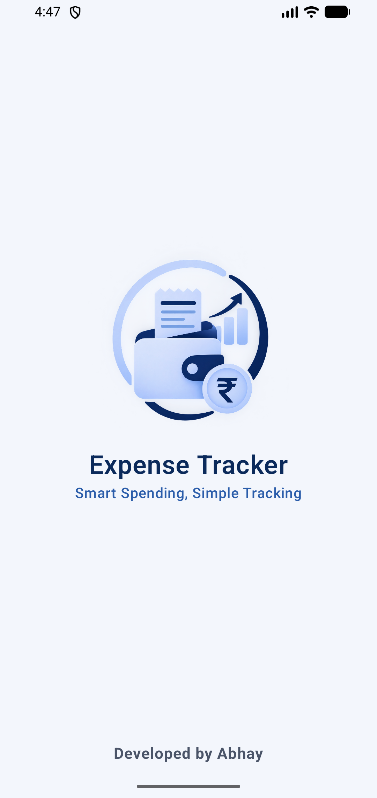
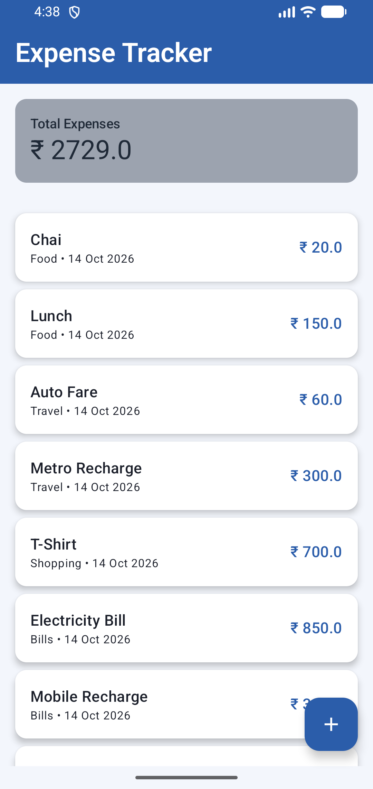
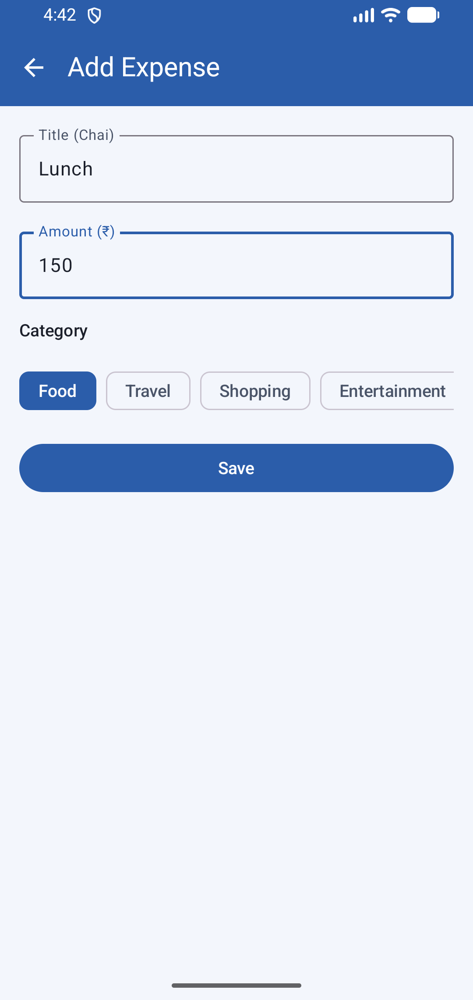
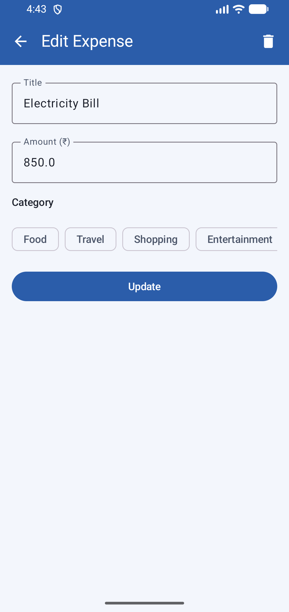
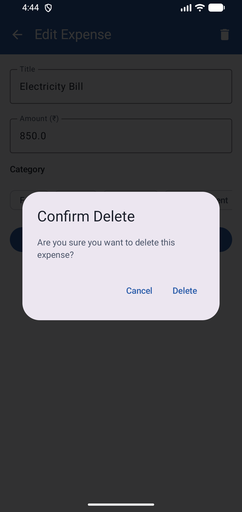
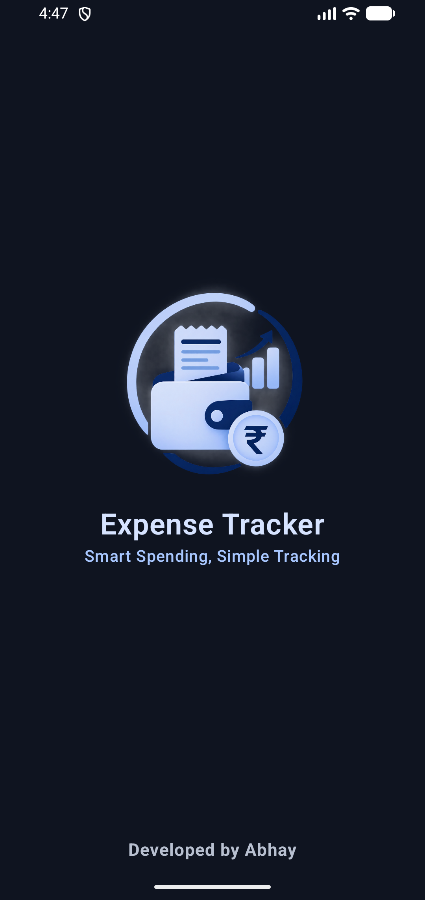
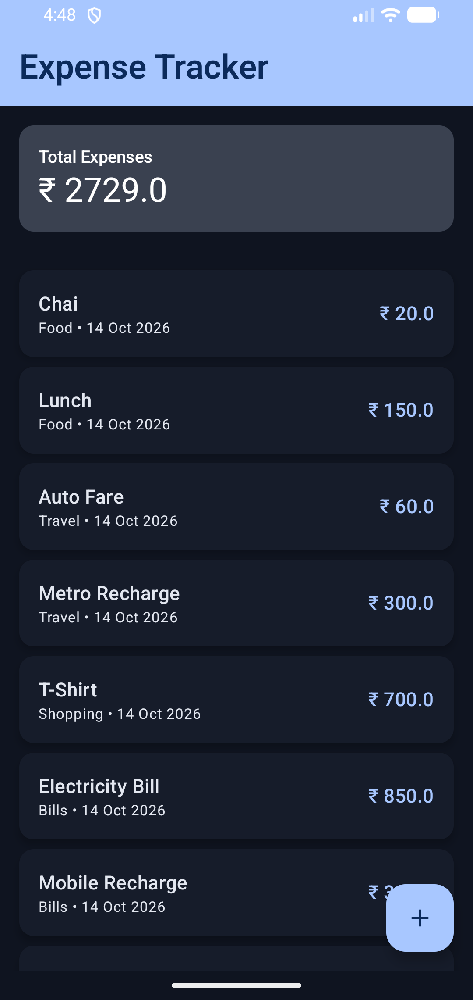
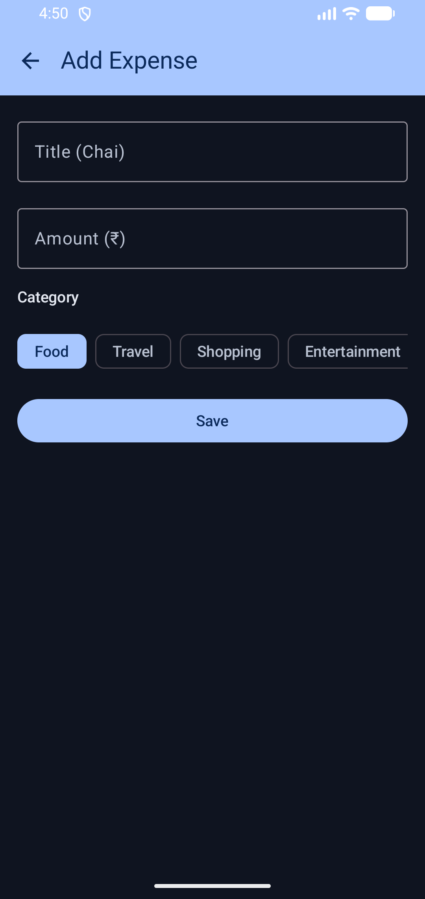

# Expense Tracker

A simple Android app to track daily expenses. You can add, edit and delete expenses, and the app shows your total spending. All data is saved on the phone, so it works without internet.

I made this project to practice Android development with Kotlin and Jetpack Compose.

## Features

- Add an expense with title, amount and category
- Edit an expense
- Delete an expense (asks for confirmation first)
- Total spending shown at the top and updates automatically
- Shows an error message if the title or amount is empty or wrong
- Data stays saved after closing the app
- Light mode and dark mode
- Custom splash screen and app icon

## Tech Used

- Kotlin
- Jetpack Compose
- Room Database
- MVVM architecture
- Navigation Compose

## Screenshots

### Light Mode

| Splash | List | Add | Edit | Delete |
|:---:|:---:|:---:|:---:|:---:|
|  |  |  |  |  |

### Dark Mode

| Splash | List | Add |
|:---:|:---:|:---:|
|  |  |  |

## How to Run

1. Download or clone this project
2. Open it in Android Studio
3. Wait for Gradle sync to finish
4. Run the app on an emulator or your phone

## Author

Abhay, Android Developer
